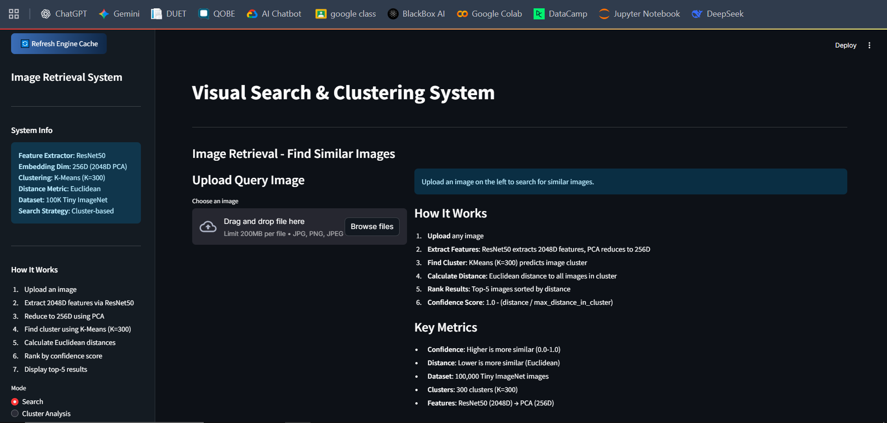
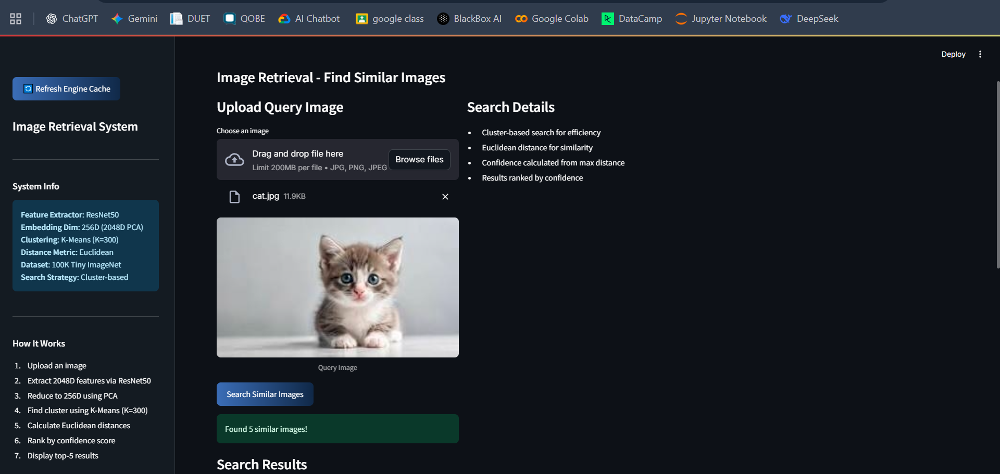
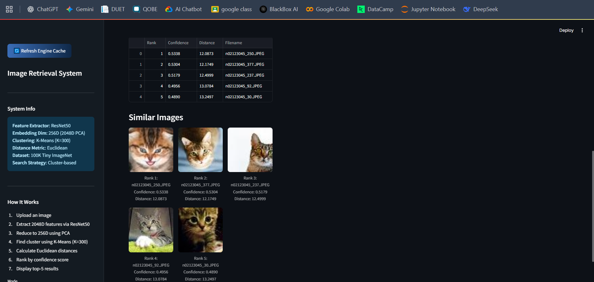
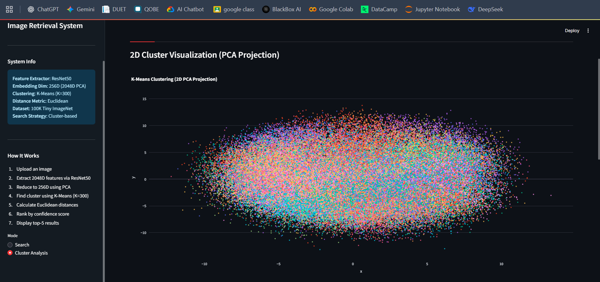
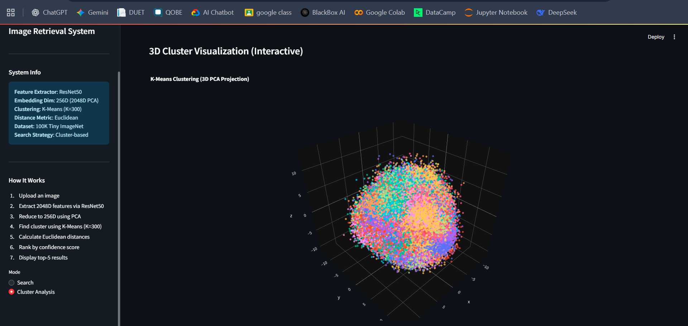

# Image Clustering & Retrieval System

## 📋 Project Overview

This project explores visual search with **PyTorch and torchvision ResNet50**, PCA feature reduction, and K-means clustering. A Streamlit interface accepts a query image, retrieves nearby images from its predicted cluster using Euclidean distance, and displays 2D and 3D cluster projections.

[Data and index artifacts](data/README.md) · [Retrieval notebook](notebooks/retrieval.ipynb) · [Screenshots](#-screenshots) · [Artifact traceability](#artifact-traceability)

### Key Features

- **Image Embedding Extraction**: Uses pretrained PyTorch ResNet50 features
- **Clustering**: Uses PCA-reduced features and K-means clusters
- **Similarity Search**: Ranks images within the query's predicted cluster by Euclidean distance
- **Interactive Web Interface**: Built with Streamlit for easy visualization and interaction
- **Cluster Visualization**: Displays 2D and 3D PCA projections of the saved embeddings

### Use Cases

- Visual search applications
- Content-based image retrieval
- Image deduplication
- Photo organization and categorization
- E-commerce product discovery

---

## 🚀 Getting Started

### Prerequisites

- A Python environment with the dependencies listed in `requirements.txt`; versions are not pinned
- pip (Python package installer)
- Virtual environment support

### Installation & Setup

#### Step 1: Clone the Repository

```bash
git clone https://github.com/UddeshayAnand/image-retrieval-system.git
cd image-retrieval-system
```

#### Step 2: Create and Activate Virtual Environment

**On Windows (PowerShell):**
```powershell
python -m venv venv
.\venv\Scripts\Activate.ps1
```

**On macOS/Linux:**
```bash
python3 -m venv venv
source venv/bin/activate
```

#### Step 3: Install Required Dependencies

```bash
pip install -r requirements.txt
```

#### Step 4: Download and Extract the Training Data

The system requires the Tiny ImageNet 200 dataset to function properly for retrieving similar images.

1. Obtain the [Tiny ImageNet 200 dataset](http://cs231n.stanford.edu/tiny-imagenet-200.zip).
2. Extract the compressed file
3. Copy the `train` folder to the `data` directory:
   ```
   data/
   ├── train/
   │   ├── n01443537/
   │   ├── n01629819/
   │   └── ... (other class folders)
   └── (other data files)
   ```

#### Step 5: Run the Application


1. Start the Streamlit application:
   ```bash
   streamlit run app/main.py
   ```

2. The application will open in your default browser at `http://localhost:8501`

---

## 📁 Project Structure

```
image-retrieval-system/
├── app/
│   ├── main.py                 # Streamlit application entry point
│   ├── ui_components.py        # UI components and styling
│   └── styles.css              # CSS styling
├── src/
│   ├── inference.py            # Inference pipeline
│   ├── utils.py                # Utility functions
│   ├── extract_images.py       # Data extraction utilities
│   └── verify_inference.py     # Verification scripts
├── data/
│   ├── train/                  # Tiny ImageNet 200 training data (to be downloaded)
│   ├── embeddings.npy          # Pre-computed image embeddings
│   ├── cluster_labels.npy      # Cluster labels
│   ├── filenames.json          # Mapping of filenames
│   ├── pca_model.pkl           # Saved PCA model
│   ├── kmeans_model.pkl        # Saved K-means model
│   └── README.md               # Index artifacts and corpus notes
├── notebooks/
│   ├── colab_training.ipynb    # Google Colab training notebook
│   ├── clustering.ipynb        # Clustering experiments
│   └── retrieval.ipynb         # Retrieval experiment and five-file export
├── assets/                    # Sample images and application screenshots
├── tests/                     # Existing tests; source-version mismatch noted below
├── requirements.txt            # Python dependencies
└── README.md                   # This file
```

---

## 🔧 Usage

### Starting the Application

1. Ensure your virtual environment is activated:
   ```powershell
   .\venv\Scripts\Activate.ps1  # Windows
   # or
   source venv/bin/activate     # macOS/Linux
   ```

2. Run the Streamlit app:
   ```bash
   streamlit run app/main.py
   ```

3. Open your browser and navigate to the provided local URL (typically `http://localhost:8501`)

### Using the Interface

- **Upload Image**: Upload an image to find similar images in the dataset
- **View Results**: Browse through clustered images and similarity scores
- **Explore Clusters**: Switch to Cluster Analysis for the saved embeddings' 2D and 3D projections

---

## 📸 Screenshots

Here are some screenshots of the application in action:

### Home Page


### Image Upload & Search Results



### Clustering Visualization



---

## 📦 Dependencies

Key dependencies used in this project:

- **PyTorch and torchvision**: Pretrained ResNet50 and image transformations
- **NumPy**: Numerical computations
- **Streamlit**: Web interface framework
- **Scikit-learn**: Machine learning utilities and clustering algorithms
- **Pillow**: Image loading and conversion
- **Pandas**: Data manipulation and analysis
- **Plotly and Matplotlib**: Interactive and notebook visualizations

For a complete list, see `requirements.txt`

---

## 🔍 How It Works

1. **Feature Extraction**: The query image is resized to 224 × 224, normalized, and processed by a pretrained PyTorch ResNet50 feature extractor.
2. **Feature Reduction**: A saved PCA model reduces the 2048-dimensional feature vector to 256 dimensions.
3. **Cluster Selection**: The saved K-means model assigns the query to a cluster, and saved labels select candidate images from that cluster.
4. **Retrieval**: Candidates are ranked by Euclidean distance to the query. The app requests the top five results and displays distance-derived scores.

The displayed score is calculated from distance relative to the maximum candidate distance in the cluster; it is not a calibrated probability of relevance. Search is restricted to the selected cluster rather than ranking the entire corpus.

## Artifact traceability

| Material | Relevant source or notebook | Traceability |
|---|---|---|
| Five supplied index files in `data/` | [retrieval.ipynb](notebooks/retrieval.ipynb), NumPy and pickle export statements | Exports all five matching filenames. The exact build that produced the supplied bundle is not established. |
| Alternative clustering experiment | [clustering.ipynb](notebooks/clustering.ipynb) | Uses its own configuration and bare output filenames; do not assume its exports are interchangeable with the supplied bundle. |
| STL10 feature/clustering experiment | [colab_training.ipynb](notebooks/colab_training.ipynb) | Uses a different dataset and exports a subset of the index filenames. |
| Application retrieval and cluster views | [inference.py](src/inference.py), [transforms](src/utils.py), and [Streamlit app](app/main.py) | Source locations for feature extraction, search, and visualization; not a record of a verified run. |
| Interface evidence | [Screenshots](assets/screenshots/) | Preserved application views; no retrieval-quality benchmark is asserted. |

Notebook exports use paths relative to their execution directory. No separate `experimental_outputs/` destination is enforced by the supplied notebook source. Keep the existing five-file bundle together rather than mixing experiment exports.

## Acknowledgments

- Tiny ImageNet dataset
- Open-source machine learning community

---
